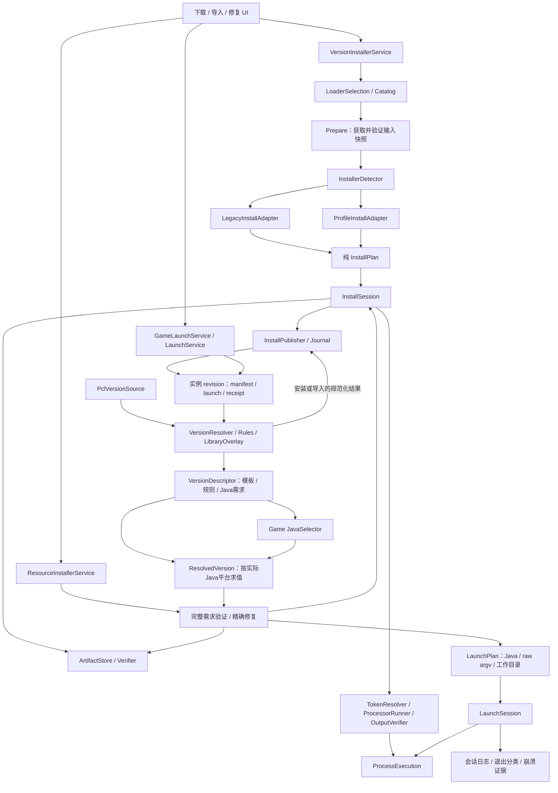

# Forge / NeoForge 安装与启动改造行动报告

日期：2026-10-19（Asia/Hong_Kong）  
仓库：`E:\OneLauncherProject\OneLauncher`  
核查基线：2026-10-19 的**文件系统当前工作树**；起始 HEAD 标识为 `22f1192e51b7106cfb2c9d780b7f71477ef5cc2e`，仅用于背景定位，源码内容直接从文件系统读取。

**建议实施方向：Forge 与 NeoForge 共用安装协议引擎，分别保留精确构件身份；安装、导入和修复发布实例独立的完整启动清单；启动只消费清单，并由会话持有进程、日志和参数文件。**

本报告是改代码之前的行动交付。本轮只新增本报告，尚未实施下文的源码修改、新增组件或测试。所有“修改”“新增”均表示拟实施内容，文件名和职责在下文明确列出。

## 1. 输入、核查范围与基线纠正

参考附件：`F:\dos\forge-architecture-20261018\Forge-NeoForge安装启动架构设计与逐项改进方案-20261018.md`，SHA-256：`1D9C9A6C8132770464C6F396B462A48FC633B8E42D14253A4FDF30B8DF695059`。

附件的 M01–M32 作为问题与设计索引；其中“本轮不修改生产源码”等语句描述附件作者当时的工作范围，不构成本次用户指令。本次先交付报告，是依据用户要求的先后顺序。附件中的示例接口、历史测试结果和建议类名，也不视为当前仓库已经具备的能力。

已静态核查安装器、版本目录、下载与校验、启动参数、进程管理、PCL 导入、Java Provider、持久登记、相关 UI，以及项目和测试入口。已有的未提交源码、平台构建与 UI 修改均作为基线保留。另一位 Agent 正在调试 AOT，期间变动以文件系统复读结果为准；本任务不改写其文件。实施时按实际差异增量修改，不用附件快照覆盖当前文件。

| 事项 | 当前代码事实 | 对行动范围的影响 |
| --- | --- | --- |
| 审查提交不同 | 附件基线为 `831e23a4…`；当前为 `22f1192e…`，且有未提交改动 | 附件结论须逐项复核，不能直接套用“已修复”状态 |
| 处理器修复组件缺失 | 当前没有 `ForgeProcessorRunner.cs`、`ForgeMappingsDownloader.cs`；Tasker 仍拼接 `Arguments`，只按退出码推进 | Runner、映射下载接管、产物闭环均纳入新增任务 |
| PCL 完整导入能力缺失 | 没有 `PclVersionResolver`、`PclImportPaths`、`ImportedLaunchArguments`、`ModLoaderVersion` 或 `HasImportedLaunchManifest`；导入仍识别主类后走默认安装 | 精确版本、父链、独立清单、安全迁移和发布需要实际实现 |
| 启动 API 已有改进 | `LaunchService.Play` 已返回单层 `Task`，每次创建独立服务且限制一次启动 | 保留现有服务外观；继续补 Completion、停止原因和双流收尾，不重复声称存在 `Task<Task>` |
| 通用 ZIP 解压已改动 | `Download.ExtractFile` 当前使用 `ZipFile.ExtractToDirectory` | 不把旧手写拼路径漏洞当成当前已复现事实；补工作目录隔离、链接策略、展开预算和覆盖策略 |
| 下载提交保护尚缺 | 当前仍有固定 `.downloading` 临时路径，没有附件提及的通用路径锁、随机临时文件和 `DownloadFileOperations` | 缓存提交保护需要新增，不能写成复用已有实现 |
| 资源服务已有用途 | `ResourceInstallerService` 已提供 `InstallMod` 外观 | 保留现有方法，扩展游戏资源 Preflight/Repair，避免破坏 Mod 安装调用方 |
| 精确选择没有端到端入口 | DownloadInfo 虽有 Forge/Neo 指定字符串，工厂和 UI 未贯通；当前下载面板只有推荐版/Beta 选项 | 通过同一 LoaderSelection 接入精确选择，不新增两套平行指定配置 |
| 库去重已有局部修复 | `VersionInfomations` 的部分库枚举已考虑 classifier；ForgeSeriesUsing 仍只按 group/artifact 建字典 | 保留有效修复，统一覆盖槽和扩展名，不退回旧实现 |
| 并行 AOT 工作补充了架构一致性 | 最终复读时，下载库、启动 classpath 与 JVM 规则已使用进程架构；AotSmoke 新增下载/classpath 架构一致性断言 | 保留这些改动，后续统一到所选 Java 架构、OS version/features 与 native 平台；不再声称当前仍全部硬编码架构 |
| 历史测试不在当前树 | 现有 `tests/OneLauncher.AotSmoke` 面向 UI/JSON/部分平台规则；`ConsoleTest` 是会访问真实环境的手工示例 | 新建隔离核心测试；附件中的 14/24 组检查与 453 Mods 导入不能计作本仓库、本轮通过 |

关键定位如下，行号以本次核查工作树为准：

| 当前问题 | 文件与定位 | 实施后应满足的行为 |
| --- | --- | --- |
| 固定要求 `version.json` 和 `data/client.lzma` | `OneLauncher.Core/Mod/ModLoader/forgeseries/ForgeSeriesInstallTasker.cs:63–65` | 按包内协议及实际引用识别；支持 legacy 和零 processor profile；未知格式明确拒绝 |
| 获取依赖就覆盖共享 loader 清单 | 同文件 `:79–84`；`DownloadMinecraftPlanner.cs:65` | Prepare 只写受控缓存/工作区，Plan 无 I/O；发布前不改正式实例 |
| processor 无 outputs 模型与验收 | `forgeseries/JsonModel.cs:114–124`；Tasker `:129–161` | 执行前可验证跳过，执行后必须验收；空 outputs 不可直接跳过 |
| 未知占位符被忽略 | Tasker `:288–307`、`:310–342` | 未知键、循环和不合法路径阻止执行，不把删参数当恢复措施 |
| 默认选择与构件身份混用 | `ForgeVersionListGetter.cs:34–48`、`:59–60`、`:114–120` | 推荐只用于初次选择，安装与修复始终保留完整 Maven version 和精确 loader |
| 校验集合被过滤 | `DownloadMinecraftPlanner.cs:69–74`；`Download.cs:558–559` | AllRequired 包含全部需求；缺文件是终检失败，同长度坏缓存可被发现 |
| 失败/取消时任务可能继续运行 | `DownloadMinecraft.cs:58–108` | 首错取消，等待所有已启动任务和进程收尾，之后才回滚 |
| UI 提前宣告完成 | `OneLauncher/Views/Panes/PaneViewModels/DownloadPaneViewModel.cs:122–128`、`:164–178` | 发布与持久登记成功后只发一次 Installed，UI 不拥有登记事务 |
| 实例可能按 MC 串选 | `GameDataManger.cs:84–97`；`GameData.cs:16–28` | instanceId 或完整组件身份匹配；同 MC 不同 Forge/Neo 实例相互独立 |
| 启动泄漏认证参数、参数文件所有权不稳 | `GameLauncher.cs:67–93`；`LaunchCommand.cs:9–34` | 会话持有参数文件直到收尾；默认诊断文件不保存完整 token |
| PCL 导入可能重新选择 loader | `Helper/ImportPCL2Version/ImportMain.cs:42–85` | 读取源清单及父链，保存精确组件；不通过默认 installer 改写导入结果 |

## 2. 新架构及职责边界



图中的安装解析和启动解析共用同一套版本模型。新安装通过 base metadata 和 loader patch 生成清单；PCL 导入通过源完整快照生成清单；启动读取已发布的完整快照，不再额外叠加共享 Forge/Neo 配置。

### 2.1 必须建立的数据契约

| 契约 | 内容与约束 |
| --- | --- |
| `LoaderSelection` | loader kind、MC、精确 loader、完整 Maven 坐标、来源及候选下载地址；显示版本、artifact version 和 JSON id 分开 |
| `PreparedInstaller / InstallerInspection` | 已验证 installer 的内容摘要、可重复读取的工作区引用、协议类型、spec、目标 MC 和引用索引；Inspect 不执行 Java |
| `InstallPlan / InstallProgress` | 完整需求、顺序步骤、依赖、预期产物和 session/step 状态；同快照与选项产生相同计划，不联网、不登记实例 |
| `ArtifactRequirement` | Remote / Embedded / Generated、逻辑坐标、受控物理路径、`long?` 长度、可用 hash、验证强度和 producer；未知长度不使用 0 代替 |
| `InstallReceipt` | installer 摘要、精确组件、producer 顺序、输入/输出摘要及执行结果；执行完成不等于实例已登记 |
| `InstanceManifest / VersionPatch` | schema、instanceId、revision、精确组件、来源、原始 metadata 引用及 patch 顺序；不保存 access token |
| `VersionDescriptor → ResolvedVersion` | 先解析模板、规则、来源与 Java 需求；选择健康 Java 后按实际平台/features 求值，得到确定的主类、参数、稳定库集及资源，避免 native 选择的循环依赖 |
| `LaunchPlan / LaunchResult` | 实际 Java、原始 argv、实例工作目录；结果保存真实退出码、停止原因、采集缺项和诊断证据 |
| `LaunchSession` | 唯一持有底层进程执行对象、输出泵、日志、参数文件和 `Task<LaunchResult> Completion`；UI 不直接处置 Process |

采用普通构造函数、少量接口和显式适配器注册。现有 Core、Core.Net 和 Avalonia 项目边界保持，避免在这次改造中同时引入新的 DI 框架或替换整个核心库。

### 2.2 Forge / NeoForge 的两轴适配

第一轴是身份：Forge、早期 Neo 的 `net.neoforged:forge`、后续 Neo 的 `net.neoforged:neoforge` 等完整构件信息。第二轴是协议：legacy `install + versionInfo`，或支持 spec 的 profile。不能仅用 `isForge`，也不能仅按 MC 大小决定安装流程。

初期目标样本：Forge 1.7.10 legacy、1.12.2 零 processor profile、1.20.1 现代 profile，以及早期和后续 Neo profile。profile 根据 `json` 字段读取版本清单，按 client side 使用 data 和 processors；不要求所有包都有 lzma。Neo 身份不因 profile 使用 Forge 字段或主类而丢失，mainClass、launchTarget、module 参数以包内清单为准。

spec 使用显式白名单，初始能力依据实际 fixture 确定；附件 `{0,1}` 是候选范围，需要逐一验证。未知 spec、MC 冲突、非 installer 包和未支持的 Pack200/特殊历史形态返回结构化 Unsupported，不猜测执行。此次以客户端官方 installer 为实施对象，server side 需要独立输入与产物合同。

Catalog 把推荐版解析成精确选择后冻结。Forge promotions 结果须回查完整目录，避免丢失历史后缀。Neo 1.20.1、新命名和 snapshot 分支集中适配，最终再次核验包内 MC。UI 的 Neo 1.20.1 屏蔽和 loader 多布尔并存也要调整，核心层保证 Forge/Neo/Fabric/Quilt 的互斥选择。

### 2.3 安装执行、资源提交和生成产物

执行顺序为：获取并验证输入 → Inspect → 纯 Plan → 准备安装依赖与原版工作副本 → 安全提取引用资源 → 原顺序运行 client processors → 验证生成产物 → 准备全部运行资源 → 完整终检 → 发布与登记。

token resolver 处理上下文、client/server data、Maven 坐标、协议 literal、归档资源和复合引用，设置 visited、深度/长度预算及保留键。只有声明为路径的值进入路径策略；hash 等普通值不创建目录。JAR Main-Class 支持续行。processor 使用 `ArgumentList`，非零退出、取消、输出缺失或不匹配均失败；stderr 作为来源保留。只有非空 outputs 全部有效才可跳过，无 outputs 的步骤仍运行并接受模型终检。

对精确识别的 `DOWNLOAD_MOJMAPS + client + version/output` 任务，可以由 .NET 下载器处理代理、缓存与完整性；这在当前树是新增能力。其他 processor 不按文件名猜测或一律改写。处理器日志与游戏日志共用底层进程收尾机制，业务结果和所有权分开。

ArtifactStore 为每个候选使用独立随机临时文件，验证长度/hash/必要结构后在目标路径锁下提交；同一构件可合并请求。竞速胜者必须是验证成功的内容。错误 200、截断、坏 hash、失败 body 均允许健康候选接管，所有 loser 取消并 await/dispose。下载过程中保留当前 Range 等有效修复，补服务端忽略 Range 与断点内容不匹配的回归。

下载型不可变库可共享；生成型库先进入实例 revision 的私有目录。processor 对原版 JAR 等可能写入的输入始终使用工作副本，不使用共享缓存作为可写 ROOT。同 Maven 地址而内容不同需报冲突或依据内容存储策略隔离，不能默认覆盖。checksum 表示内容一致性，不能单独充当来源认证；工作目录和 SafePath 也不能限制 Java processor 的操作系统权限。

### 2.4 实例存储、发布和恢复

建议布局如下，真实路径由显式 `PathLayout(gameRoot, instanceId, revision)` 生成：

```text
GameRoot/
  versions/<MC>/version.json + 原版 JAR     受控 metadata/JAR 缓存
  libraries/                              已验证下载型库
  assets/                                 index 和 objects
  .install-staging/<session>/              同卷工作区、临时文件、journal
  instance/<instanceId>/
    .onelauncher/
      current.json                        原子替换的 revision 引用
      revisions/<revision>/
        instance.json                     schema、身份、组件和来源
        launch.json                       完整、无认证秘密的启动模板
        receipt.json                      执行来源与输入/输出摘要
        metadata/                         原始 JSON 与规范化 patch
        generated-libraries/              当前 revision 的生成型产物
    natives/<runtime-platform>/
    logs/sessions/<sessionId>/
    mods/ config/ saves/ options.txt       用户内容
```

revision 只包含启动器管理的 metadata 与生成产物，发布不替换整个实例根目录。清单/receipt 使用相对 revision 的路径或可解析的逻辑地址，发布后不得残留 staging 的绝对路径。`GameData` 继续承载显示名称、账号 ID 和用户选项，并增加 schema/manifest 引用；账号密钥仍由原账号系统管理。`current.json` 是选中 revision 的事实，配置数据库中的 manifest 引用是可恢复索引，二者不依赖一次普通 Save 假装成为 OS 事务。启动只读取一次 current 并固定持有该 revision，索引不能覆盖这个选择。

InstallSession 获得实例锁；先完成全部验证并写入 Prepared journal，再将 revision 放到目标卷正式位置；写明发布意图后原子切换 current 引用，持久登记索引，最后写 Committed。journal 保存前后 revision/索引状态，恢复时检查实际目录、指针和配置，覆盖操作已发生但阶段记录尚未写入的断电窗口。数据库/指针文件采用同目录临时文件、flush 和受支持的原子替换；不承诺所有文件系统上零窗口的硬件持久性。

旧 revision 保留至本次提交完成，并考虑正在运行会话的引用；修复或升级不删除运行中会话所用文件。Generated 修复也在新工作区重建并发布新 revision，不原地写已发布产物。出现首个失败时取消同会话其他工作，等待全部已启动任务与进程收尾，再回滚本次指针/登记并清理工作区。恢复/回滚仅在指针和索引仍符合本事务预期状态时进行，按实例合并或撤销登记，不能恢复整份旧配置覆盖其他实例的提交；共享配置保存串行，恢复操作幂等。清理异常附加到原异常。新建实例失败不留下成功索引，更新失败保留旧 revision；启动恢复处理未完成 journal，而不是只依赖 catch。

### 2.5 统一版本解析、启动和修复

VersionResolver 处理父链 visited/深度预算、来源、base→loader→显式组件→用户覆盖。完整导入快照不重复叠 loader。Maven 构件身份包含 version，覆盖槽采用大小写敏感的 `group:artifact:classifier@extension`，合并稳定且能处理重复项。legacy 参数和自定义参数由专用 tokenizer 解析，现代 JVM/game 参数保留规则与 string/list 形式。

解析分两步：先从清单得到带 Java 需求、未求值规则的 VersionDescriptor，选定 GameJava 后再形成平台相关的 ResolvedVersion 和 AllRequired。RuleEvaluator 使用实际 features、OS/version 和所选 Java 的架构；有 rules 时初始拒绝，按原顺序更新匹配结果。native、classpath、下载和启动使用同一套规则。assets 同时支持 index 校验、有界恢复及历史 virtual/map_to_resources 布局。

ResourceInstallerService 的 Preflight 从 ResolvedVersion 枚举 AllRequired：主 JAR、库、native、asset index/objects、logging、generated，以及被清单引用的 metadata/receipt。index 先校验再解析和派生 objects 需求，坏 index 有界重新获取；原始 metadata/receipt 的引用与内容摘要也必须一致。先验证后修复，最终仍校验完整集合，输出 VerifiedLaunchResources 后才能创建可执行 LaunchPlan。Remote 可下载，Embedded 从固定 installer/receipt 获取，Generated 通过精确 producer 补输入并重跑必要步骤及后继；不重新选择推荐 loader。无 receipt 的旧导入在有效资源齐全时可启动，缺生成型资源时返回来源不足及可执行恢复选项。

LaunchCommandBuilder 和各 Builder 逐步改为只消费 ResolvedVersion，产出原始 argv，路径替换不预加引号；启动用 `ProcessStartInfo.ArgumentList`，工作目录为计划的 gameDirectory。Java 9+ 长命令按专用 argfile 规则编码，Java 8 采用单独验证的兼容策略；验证前明确返回命令过长，不直接使用 `@file`。预算计算包含实际整条命令。

保留现有 `GameLaunchService → LaunchService → IGameLauncher.Play` 外观，内部引入 StartAsync 返回 LaunchSession，Play await 同一 Completion。ProcessExecution 负责底层进程/输出泵；LaunchSession 唯一持有它并负责 Stop、日志和参数文件。Completion 等待进程退出、双流收尾、日志队列 flush/关闭、参数资源清理尝试和结果分类；清理失败保存为 issue，DisposeAsync 做幂等兜底。StartAsync 在返回 session 前失败时负责清理已创建资源。继承句柄导致不 EOF 时使用独立 drain 预算并记录 OutputIncomplete。取消等待与显式停止分开，不用已取消 token 跳过收尾；默认对相同 canonical gameDirectory 禁止并发启动，不同实例目录可并行。

原始 stdout/stderr 始终按 session 保存，有界队列、轮转和明确截断标记；UI 批量订阅，不决定采集是否开启。Started 表示进程创建，Ready 是额外可选信号。退出分类保留真实 exit code 和 UserStopped 等原因，结合本会话新证据判断，缺日志不覆盖原错误。默认不再写完整 LastLaunchArgs.bat，分享报告与参数快照按策略脱敏。

JavaCatalog 支持同 major 多路径/vendor/arch，Probe 有超时、kill/drain 和健康缓存；InstallerJava 与 GameJava 分别选择。metadata 优先，兼容表仅处理已验证旧版本，未来命名/snapshot 未知时不按数字猜测。Provider 保留 checksum/size/arch 等发布元数据，runtime 在 staging 解压、定位、probe 通过后发布；失败保留旧 Java。GC flags、内存 MiB 和 mods 计数一并纠正。

## 3. 拟修改的现有文件

以下路径相对仓库根目录；每行列出的文件均为拟修改对象。阶段定义见第 5 节。兼容入口保留到调用方完成迁移，不提前删除共享 loader 文件。

| 编号 | 文件 | 具体变化 | 阶段 |
| --- | --- | --- | --- |
| E01 | `OneLauncher.Core/Mod/ModLoader/forgeseries/ForgeVersionListGetter.cs` | 旧 URL API 适配到 Catalog，返回/贯通精确选择与 cancellation | S1 |
| E02 | `OneLauncher.Core/Mod/ModLoader/forgeseries/JsonModel.cs` | 旧 DTO 兼容桥；补源生成注册，统一版本模型，移除 object 协议歧义 | S1 |
| E03 | `OneLauncher.Core/Mod/ModLoader/forgeseries/ForgeSeriesInstallTasker.cs` | 拆出 Inspect/token/processor/outputs；最终成为兼容外观，移除正式目录提前写入 | S1 |
| E04 | `OneLauncher.Core/Downloader/DownloadMinecraftProviders/ModSources/ForgeProvider.cs`、`NeoforgeProvider.cs` | 缩为选择及身份适配，去重复和 lzma 全局前置条件 | S1 |
| E05 | 同目录 `IModLoaderConcreteProviders.cs`、`FabricProvider.cs`、`QuiltProvider.cs` | 增加准备快照/计划和 token 边界；Fabric/Quilt 通过兼容适配保持可用 | S1 |
| E06 | `OneLauncher.Core/Downloader/DownloadMinecraftProviders/DownloadInfo.cs`、`DownloadInfoCreater.cs` | 贯通 LoaderSelection、显式根路径与实例身份，拆离创建请求时的下载副作用 | S1 |
| E07 | 同目录 `DownloadMinecraft.cs`、`DownloadMinecraftPlanner.cs`、`DownloadMinecraftProvider.cs` | 完整需求/待下载分开；输入先验；任务归 InstallSession；native 与处理器调用新服务 | S0–S2 |
| E08 | `OneLauncher.Core/Downloader/Download.cs`、`RaceDownloader.cs` | 验证后提交、随机临时文件、路径锁、取消传播、loser 收尾、完整校验和安全归档转接 | S0 |
| E09 | `OneLauncher.Core/Services/VersionInstallerService.cs`、`ResourceInstallerService.cs` | 安装入口统一 session 与发布登记；保留 InstallMod，新增 Preflight/Repair | S1–S2 |
| E10 | `OneLauncher.Core/Helper/Models/GameData.cs`、`UserVersion.cs`、`SomeClasses.cs` | 增 schema/manifest/精确组件引用；loader 互斥；VersionPath 不再隐式绑定全局根 | S1–S2 |
| E11 | `OneLauncher.Core/Global/ModelDataMangers/GameDataManger.cs`、`BasicDataManger.cs`、`DBManager.cs` | 精确实例查找、可恢复索引登记和原子配置保存；旧 JSON 与默认映射兼容 | S1–S2 |
| E12 | `OneLauncher.Core/Global/Init.cs`、`UnitedCore.cs`、`TaskManager.cs` | 组合新服务、启动恢复 journal；typed 状态和终态一次性，不让按钮取消先伪造完成 | S0–S3 |
| E13 | `OneLauncher.Core/Minecraft/JsonModels.cs`、`VersionInfomations.cs`、`VersionAssetIndex.cs` | 完整 metadata/rules/legacy/size 模型、解析与资源共用；旧读取 API 适配 | S1–S2 |
| E14 | `OneLauncher.Core/Mod/ModLoader/forgeseries/ForgeSeriesUsing.cs`；`OneLauncher.Core/Launcher/Strategys/ForgeStrategy.cs`、`NeoForgeStrategy.cs`、`IModArgStrategy.cs` | S1 新 manifest 路径跳过策略；S2 将共享配置限制为旧数据迁移输入，统一稳定库覆盖 | S1最小/S2完整 |
| E15 | `OneLauncher.Core/Launcher/LaunchCommandBuilder.cs`、`LaunchCommand.cs` | raw argv/LaunchPlan；S1 接新 manifest 与私有 generated 的启动；旧 LaunchCommand 适配退场，参数文件交 session | S0–S2 |
| E16 | `OneLauncher.Core/Launcher/Builders/ClassPathBuilder.cs`、`JvmArgsBuilder.cs`、`GameArgsBuilder.cs` | S1 消费新清单/物理路径/raw argv；S2 完成全部旧路径迁移，消除重复 loader 参数 | S1最小/S2完整 |
| E17 | `OneLauncher.Core/Launcher/Builders/ExtraJvmArgsBuilder.cs`；`OneLauncher.Core/Helper/Models/JvmArgument.cs`；`OneLauncher.Core/Helper/SystemMemoryHelper.cs`、`Tools.cs` | Maven/token 方法转接；Java 回退规则、GC 能力、MiB 与 mods 计数纠正 | S0/S1/S3 |
| E18 | `OneLauncher.Core/Launcher/GameLauncher.cs`、`LaunchService.cs`、`IGameLauncher.cs`；`OneLauncher.Core/Services/GameLaunchService.cs` | 保留独立单次服务，接 StartAsync/session/typed result，修取消收尾、日志与秘密落盘 | S0–S3 |
| E19 | `OneLauncher.Core/Helper/ImportPCL2Version/ImportMain.cs`、`JsonModels.cs`、`SetupFucker.cs` | PCL 来源适配，完整父链与精确组件，安全迁移、staging 发布；保留对旧 Setup 的读取兼容 | S2 |
| E20 | `OneLauncher.Core/Global/JavaManager.cs` | 旧配置迁移为候选，健康探测与分用途选择，安装调用事务发布 | S1最小选择/S3完整 |
| E21 | `OneLauncher.Core.Net/JavaProviders/BaseJavaProvider.cs`、`IJavaProvider.cs`、`AdoptiumAPI.cs`、`AzulZuluAPI.cs`、`MicrosoftBuildofOpenJDKGetter.cs`、`GraalVMGetter.cs`、`OracleJDK.cs` | 获取并贯通完整 release 校验/架构元数据，统一安全解压、binary 定位、probe、发布；移除覆盖前先删旧目录 | S0归档/S3事务 |
| E22 | `OneLauncher/Views/Panes/PaneViewModels/DownloadPaneViewModel.cs`、`OneLauncher/Views/Panes/DownloadPane.axaml` | 显式 loader 单选、精确版本选择、Neo 1.20.1 能力门控；移走 UI 登记事务，按 Installed 显示成功 | S1–S2 |
| E23 | `OneLauncher/Views/ViewModels/HomePageViewModel.cs`、`VersionPageViewModel.cs`、`GameDataPageViewModel.cs`；`OneLauncher/Views/Panes/PaneViewModels/PowerPlayPaneViewModel.cs`、`EditGameDataPaneViewModel.cs` | 导入/启动/快捷启动均绑定 instance 与 session；编辑项不改已安装精确身份，进度与取消贯通 | S2–S3 |
| E24 | `OneLauncher/Codes/LaunchGame.cs`；`OneLauncher/Views/Windows/WindowViewModels/GameTaskerViewModel.cs`、`OneLauncher/Views/Windows/GameTasker.axaml`、`GameTasker.axaml.cs` | UI 消费日志/诊断；去全局同步读日志、Debug 才采集、每行 Post/复制整段；保留现有 50 KB 截断并补 SessionId 与有界调度 | S0/S3 |
| E25 | `OneLauncher/Views/Panes/PaneViewModels/JavaInstallPaneViewModel.cs`；`OneLauncher/Views/ViewModels/SettingsPageViewModel.cs` | 展示健康候选、用途与不兼容原因；与 Java 事务进度接轨 | S3 |
| E26 | `OneLauncher.sln`、`OneLauncher.Core/OneLauncher.Core.csproj`、`ConsoleTest/ConsoleTest.csproj`、`tests/OneLauncher.AotSmoke/Program.cs`、`.github/workflows/dotnet-desktop.yml` | 接核心测试/fixture、必要 internal 测试可见性、取消 ConsoleTest 重复导入共享源码；新增 JSON/AOT 入口检查和 CI 作业 | 全程 |

上述路径中省略前缀的文件继承同一单元格中明确给出的目录。`Directory.Build.props/targets`、`global.json`、现有跨平台发布 profile 及登录实现不列为本次重写对象；如新测试必须接入既有 build 校验，只做最小适配。Core.Net 的共享编译声明继续由 Core 引入，新增 Java 契约放 Core 中，避免新建平行程序集重复编译同一源码。

## 4. 拟新增的文件

这是分阶段的目标总清单，非一次性大提交。DTO、结果类型和显式注册按领域合并，相关小 helper 放入对应文件，避免为每个 M 编号各建一个服务。以下均为新增能力，当前不存在同名实现。

### 4.1 基础设施、安装与协议引擎

| 编号 | 拟新增路径 | 职责 | 首次阶段 |
| --- | --- | --- | --- |
| N01 | `OneLauncher.Core/Installation/InstallModels.cs` | LoaderSelection、request/context、snapshot、plan/step、receipt、progress/result 与 installer 接口 | S0–S1 |
| N02 | `OneLauncher.Core/Installation/InstallSession.cs` | linked token、锁、任务/资源所有权、失败 drain、验证和发布编排 | S0–S1 |
| N03 | `OneLauncher.Core/Installation/InstallPublisher.cs` | journal 模型、原子指针/索引发布、回滚与启动恢复 | S1 |
| N04 | `OneLauncher.Core/Installation/InstallJsonContext.cs` | 安装、receipt、journal 等源生成 JSON 契约 | S1 |
| N05 | `OneLauncher.Core/Helper/IO/SafePath.cs` | canonical 边界、绝对/UNC/ADS、链接/reparse 和受控根验证 | S0 |
| N06 | `OneLauncher.Core/Helper/IO/SafeArchive.cs` | 安全提取引用、条目/字节预算、取消与覆盖策略 | S0 |
| N07 | `OneLauncher.Core/Minecraft/PathLayout.cs` | 显式根、实例、revision、缓存、native 与日志布局 | S0–S1 |
| N08 | `OneLauncher.Core/Minecraft/MavenCoordinate.cs` | 坐标、classifier/@extension、逻辑路径、覆盖槽解析 | S1 |
| N09 | `OneLauncher.Core/Artifacts/ArtifactModels.cs` | 全量需求（含 index 与 metadata）、来源、验证状态/强度、producer、VerifiedLaunchResources 和完整/待传输集合 | S0 |
| N10 | `OneLauncher.Core/Artifacts/ArtifactVerifier.cs` | 长度/hash/模型验证，缺失/不可读明确失败，有界并发和 finally 收尾 | S0 |
| N11 | `OneLauncher.Core/Artifacts/ArtifactStore.cs` | 单路径锁、请求去重、临时文件、内容验证与提交，转接现有传输实现 | S0 |
| N12 | `OneLauncher.Core/Mod/ModLoader/forgeseries/LoaderCatalog.cs` | Forge/早期 Neo/后续 Neo 的精确目录适配与候选来源 | S1 |
| N13 | 同目录 `InstallerDetector.cs` | 只读归档检查、结构冲突/spec/MC 校验和格式选择 | S1 |
| N14 | 同目录 `InstallerModels.cs` | legacy/profile/data/outputs/inspection DTO 与显式 JSON 注册 | S1 |
| N15 | 同目录 `LegacyInstallAdapter.cs` | install/versionInfo、payload 提取、legacy 参数和父版适配 | S1 |
| N16 | 同目录 `ProfileInstallAdapter.cs` | json 指针、内嵌 Maven、client data/processors 的共同计划 | S1 |
| N17 | 同目录 `InstallerTokenResolver.cs` | 复合 token/data、归档引用、字面值、循环/预算与类型校验 | S1 |
| N18 | 同目录 `ForgeProcessorRunner.cs` | processor classpath/Main-Class 续行、raw argv、执行日志和统一进程结果 | S1 |
| N19 | 同目录 `ForgeMappingsDownloader.cs` | 精确 Mojmaps 下载语义适配，复用 ArtifactStore 与 outputs 校验 | S1 |
| N20 | 同目录 `ProcessorOutputVerifier.cs` | 有效跳过/执行后验、关键产物与 receipt 对接 | S1 |
| N21 | `OneLauncher.Core/Processes/ProcessExecution.cs` | Process、双流 pumps、退出等待、kill/drain 和部分输出状态；由业务 session 唯一持有 | S0 |

### 4.2 完整清单、启动会话、Java 与诊断

| 编号 | 拟新增路径 | 职责 | 首次阶段 |
| --- | --- | --- | --- |
| N22 | `OneLauncher.Core/Minecraft/Resolution/VersionModels.cs` | InstanceManifest、VersionPatch、VersionDescriptor、ResolvedVersion、RuntimePlatform、来源与源生成上下文 | S1最小/S2完整 |
| N23 | 同目录 `VersionResolver.cs` | 父链/完整快照解析、稳定 LibraryOverlay、字段来源与 Java 约束 | S1最小/S2完整 |
| N24 | 同目录 `RuleEvaluator.cs` | OS/version/arch/features 的统一顺序规则 | S1–S2 |
| N25 | 同目录 `ArgumentTokenizer.cs` | legacy minecraftArguments 与用户自定义参数语法，独立入口和错误定位 | S1–S2 |
| N26 | `OneLauncher.Core/Minecraft/Instances/InstanceManifestStore.cs` | revision 文件读写、schema 检查、hash/引用一致性；不负责账户或 UI | S1 |
| N27 | 同目录 `LegacyInstanceMigrator.cs` | 从共享旧数据建立可确认的实例快照；未知精确历史身份返回需选择 | S2 |
| N28 | `OneLauncher.Core/Helper/ImportPCL2Version/PclVersionSource.cs` | PCL 源定位、Setup 兼容、安全路径映射与 metadata 来源，复用通用 resolver | S2 |
| N29 | `OneLauncher.Core/Artifacts/ResourceRepairPlanner.cs` | AllRequired Preflight、index 先验再派生 objects、精确 producer 修复依赖与验证结果 | S1验证/S2完整修复 |
| N30 | `OneLauncher.Core/Launcher/LaunchPlan.cs` | 实际 Java、raw argv、工作目录、资源引用和无秘密诊断视图 | S0合约/S1新路径/S2统一 |
| N31 | 同目录 `LaunchSession.cs` | Completion/LaunchResult、StopReason、底层执行/参数文件/日志唯一所有权 | S0 |
| N32 | 同目录 `LaunchArgumentMaterializer.cs` | 引用类型参数资源、Java 9+ argfile、Java 8 长命令能力门控和清理 | S0–S2 |
| N33 | `OneLauncher.Core/Logging/SessionLogStore.cs` | typed 原始日志、有界持久队列、轮转/gap、UI 批次订阅 | S0基础/S3完整 |
| N34 | 同目录 `GameLogParser.cs` | ANSI、旧/新日志格式、异常链、未知行保留和匹配预算 | S3 |
| N35 | `OneLauncher.Core/Diagnostics/CrashModels.cs` | evidence、collection issues、分类、confidence 和建议模型 | S3 |
| N36 | 同目录 `CrashCollector.cs` | 会话前后快照、实例日志与新增报告收集，不遮原错误 | S3 |
| N37 | 同目录 `ExitClassifier.cs` | 退出码、停止原因、日志/文件证据的退出分类 | S3 |
| N38 | 同目录 `CrashAnalyzer.cs` | 显式注册规则与证据定位，不依赖反射扫描，不自动改 Mod/存档 | S3 |
| N39 | 同目录 `LaunchReportExporter.cs` | 脱敏 plan/分享报告；秘密筛查 helper 同时供本地诊断快照调用 | S0基础/S3完整 |
| N40 | `OneLauncher.Core/Runtime/Java/JavaModels.cs` | JavaInstallation、requirement/capabilities、ProviderRelease 与 JSON 上下文 | S1最小/S3完整 |
| N41 | 同目录 `JavaCatalog.cs` | 多路径/vendor/arch 候选、旧配置迁移、健康缓存与有界发现 | S3 |
| N42 | 同目录 `JavaProbe.cs` | java 实际版本/属性探测、超时和进程收尾 | S1最小/S3完整 |
| N43 | 同目录 `JavaSelector.cs` | Installer/Game 分用途约束选择、兼容解释与未知需求处理 | S1最小/S3完整 |

N26 首次接入 S1，保证新安装初次发布就拥有独立清单；S2 完成迁移和修复入口。S1 不依赖 S3 的完整 Java 自动发现，但必须具备探测指定 Java 和分别验证两类需求的最小能力。

### 4.3 测试与 fixture 文件

| 拟新增路径 | 覆盖目标 |
| --- | --- |
| `tests/OneLauncher.Core.Tests/OneLauncher.Core.Tests.csproj` | 独立核心测试项目，引用 Core 成品，不再次导入 Core.Net 共享源码，不初始化真实 Init/账号 |
| 同目录 `InstallerFormatTests.cs`、`ProcessorTests.cs` | 协议/身份/token/Maven/outputs/续行/Main-Class 与真实子进程参数、尾行、取消 |
| 同目录 `ArtifactTests.cs`、`VersionResolverTests.cs` | 坏缓存、竞速、归档边界、rules/父链/覆盖槽/历史 assets 与 native |
| 同目录 `InstallTransactionTests.cs`、`LaunchSessionTests.cs` | 故障注入、journal 断点恢复、并发/取消/一次 Completion/参数文件与脱敏 |
| 同目录 `JavaTests.cs`、`PclImportTests.cs` | 候选/约束/Provider 回滚、精确导入/安全迁移/未知来源 generated |
| 同目录 `DiagnosticsTests.cs` | 日志格式/截断/异常链、退出分类、收集缺项、规则证据及误报、报告脱敏 |
| 同目录 `Fixtures/manifest.json`、`Fixtures/Fetch-OfficialFixtures.ps1`、`Fixtures/README.md` | 固定来源、完整版本、原包 SHA-256、预期协议；下载脚本验证已审核摘要，不在测试中动态追 latest |
| `tests/OneLauncher.ProcessFixture/OneLauncher.ProcessFixture.csproj`、`Program.cs` | 可控制的 argv 回显、双流、秒退、长运行、继承句柄与进程树 fixture |

合成 ZIP/profile fixtures 在测试临时根生成；官方 installer 的具体完整坐标与摘要在取样核验后填入清单，当前报告不捏造 hash。Java 8/17/21 的参数文件行为与实际 Forge/Neo 启动还需真实 JVM/游戏验收，.NET fixture 只证明进程与 argv 边界。

## 5. 分阶段落地顺序、依赖与退出条件

| 阶段 | 实施内容 | 可审核交付与退出条件 |
| --- | --- | --- |
| S0：先建立可控的失败边界 | 基线测试；SafePath/Archive；AllRequired 与验证后提交；后台任务收尾；通用 ProcessExecution；会话/参数资源所有权；去默认秘密落盘 | 错误内容不作为 installer/native/processor 输入；取消传播且所有任务结束；旧缓存/旧实例不因失败被覆盖；正常长运行 Play 不早完成，取消后 kill/drain、日志与参数文件清理可验证 |
| S1：精确身份和安装闭环 | Catalog、协议 DTO/Detector、legacy/profile adapters、token、runner/outputs/Mojmaps；Prepare/Plan 分离；最小版本解析与 Installer/Game Java 校验；receipt、私有 generated、独立清单、journal 发布及 manifest→ResolvedVersion→raw argv 的新实例启动适配 | 目标 Forge/Neo fixtures 得到正确格式和身份；exit 0 无有效产物拒绝；零 processors 合法但必须终检；新安装首次发布即实例独立且可被启动入口消费；Installed 在持久登记后产生，保存失败可恢复 |
| S2：统一普通/导入/修复/启动 | 完整 resolver/rules/assets/native；raw argv；旧数据迁移；PCL source adapter；Preflight 与 producer 修复；去新路径共享策略；UI 精确选择和状态接入 | 同 MC 两个 Forge 与一个 Neo 共存；安装 B 不改 A；PCL 父链/精确版本不变且源目录只读；删除资源后按来源修复，不升级 loader；非默认根、中文空格路径无交叉写入 |
| S3：Java、诊断与发布验收 | 完整 JavaCatalog/Provider 事务、GC/内存；有界日志/分类/证据规则；UI 状态与 AOT/跨平台实际验收 | 有故障证据与明确缺项；主动停止和真实崩溃可区分；Java 替换失败仍可用旧 runtime；按平台/架构/loader 样本记录安装、主菜单、进入世界三层结果 |

建议按阶段内的小提交或 PR 推进，每份交付包含源码、必要回归和实际验证记录。S0 的合约先保持最小范围，避免为了最终蓝图一次改齐全部目录。S1 提前实现最小 resolver/manifest/Java 选择及启动适配，是依赖闭环需要；不能把这些全部拖到后续阶段，导致新安装继续覆盖共享配置、使用错误 Java，或发布后还只能由旧策略启动。S2 扩展旧数据/PCL/完整资源修复，不承担新实例首次可启动的前提。

迁移期间优先级：路径/验证/收尾等直接错误边界优先；其次让安装产生可信、独立结果；随后统一导入与启动；最后扩展诊断和 Java 管理体验。源生成 JSON 和取消传递贯穿每一阶段，不能留到最终 AOT 发布时集中补。

旧数据迁移采用读取旧文件→确认精确身份与资源→发布新 revision→写迁移标记。无法确认被旧共享配置覆盖的历史 loader 时，不从当前推荐版或主类伪造恢复；让用户提供精确选择或修复来源。保留旧文件以便回退，达到迁移验收后再单独评估旧策略清理。用户 Mods、配置和存档不由资源修复自动删除或替换。

## 6. M01–M32 对照，避免遗漏与重复建设

| 附件条目 | 本报告实施落点 | 关键验收 |
| --- | --- | --- |
| M01 精确 Catalog | E01/E06/E22，N01/N12，S1 | 历史 Forge 完整后缀、早期 Neo、无补丁号 MC 与新命名不串版本 |
| M02 格式分派 | E03，N13/N15/N16，S1 | legacy、零 processor、json 指针、未知 spec/MC 冲突 |
| M03 协议 DTO | E02/E13，N04/N14/N22，S1 | outputs/data/rule-valued 参数完整且源生成可达 |
| M04 身份适配 | E04/E05，N12/N15/N16，S1 | 早期 Neo profile 即使写 forge，结果身份仍为 Neo |
| M05 Prepare/Plan | E06/E07/E09，N01/N02，S1 | 同 snapshot 重复 Plan 相同，无网络或正式目录写入 |
| M06 占位符 | E03/E17，N08/N17，S1 | 复合/递归、归档引用、classifier@extension、未知/循环失败 |
| M07 processor 运行 | E03，N18/N19/N21，S1 | raw argv、双流尾行、取消树、续行 Main-Class、Mojmaps 精确接管 |
| M08 outputs/receipt | N01/N10/N20，S1 | 同大小坏产物、exit 0 缺文件、有效跳过、空 outputs 不跳过 |
| M09 安全路径/工作副本 | E08/E21，N05/N06/N07，S0–S1 | 越界/链接/预算拒绝；共享原版输入不被 processor 写坏 |
| M10 安装事务 | E07/E09/E11/E12/E22，N02/N03/N26，S0–S2 | 各阶段取消/登记失败/断电恢复、同实例锁与旧 revision 保留 |
| M11 实例精确身份 | E06/E10/E11，N01/N22/N26，S1–S2 | 同 MC 多 loader/版本共存，不按第一个实例串选 |
| M12 共用版本解析 | E13/E19，N22/N23/N28，S1–S2 | 父链缺失/循环有来源；完整导入无重复叠加 |
| M13 Maven/覆盖槽 | E14/E16/E17，N08/N23，S1–S2 | classifier/extension/重复项稳定，逻辑坐标与物理路径分开 |
| M14 LaunchPlan/raw argv | E15/E16/E18，N25/N30/N32，S0–S2 | S1 新 manifest 启动贯通；中文、空格、引号、空值、module-path、自定义参数与实际 argv |
| M15 显式路径上下文 | E06/E10/E13/E14，N07，S0–S2 | 多根并行与非默认根不落到 Init 全局目录 |
| M16 唯一会话所有权 | E18/E24，N21/N31，S0 | 保留单层 Task；秒退/长运行/Stop/Dispose，Completion 一次且真实收尾 |
| M17 会话日志 | E18/E24，N33/N34，S0/S3 | Debug 关闭仍采集；UI 关闭不丢证据；洪泛有界并标缺口 |
| M18 退出分类 | E18/E24，N35/N37，S3 | 主动 stop、0+crash、非零未知、旧报告不误关联 |
| M19 证据与分析 | E24，N35/N36/N38，S3 | 缺文件不遮原错误；规则有证据/置信度和误报样本 |
| M20 参数与秘密 | E15/E18/E24，N31/N32/N39，S0–S2 | 无默认完整 token 文件；启动失败/取消/正常退出正确清理；Java 8 单独验证 |
| M21 Preflight/修复 | E09/E18，N09/N29，S2 | 库/assets/native/generated 按来源修复，离线完整可用 |
| M22 全量验证/收尾 | E07/E08，N02/N09/N10，S0–S2 | 已有坏缓存和缺文件被检出；并发 1、首错/排队取消不挂起 |
| M23 有效内容竞速 | E08，N11，S0 | 错误 200/截断/坏 hash/慢源健康回退，loser 全部释放 |
| M24 统一资源/规则 | E07/E13，N22/N24/N29，S1–S2 | name-only/未知 size/坏 index/virtual/features/native arch |
| M25 Java 目录/探测 | E20/E25，N40/N41/N42，S3 | 死路径、同 major 多候选、PATH 错版本、卡住 probe、架构不符 |
| M26 Java 需求/选择 | E17/E20，N40/N42/N43，S1/S3 | metadata 优先；旧版本边界/snapshot 未知；两用途 Java 可不同 |
| M27 Java 事务安装 | E20/E21，N05/N06/N40/N42，S3 | checksum/归档/probe/取消失败旧 runtime 与配置保留 |
| M28 GC/内存/Mod 计数 | E17，N40/N43，S3 | Java 8/17/21 能力差异、MiB 边界、mods 子目录实际计数 |
| M29 PCL 来源适配 | E19/E23，N23/N26/N28/N29，S2 | 从当前缺失状态建立能力；精确组件、源 JSON 不变、安全迁移和来源不足诊断 |
| M30 UI typed 状态 | E12/E22/E23/E24/E25，N01/N31，S1–S3 | 总量未知不伪造百分比、终态一次、多 session 不串按钮 |
| M31 旧数据迁移 | E10/E11/E14，N26/N27，S2 | 可确认旧实例生成快照；无法确认历史身份不伪造 |
| M32 AOT/编译归属 | E02/E13/E26，N04/N14/N22/N40，贯穿 | 禁反射 JSON/显式注册、Core 测试不重复共享源码、实际发布与 UI 操作分别验收 |

## 7. 验证计划与发布标准

本轮只做静态审查和报告一致性检查，没有执行真实下载、installer、游戏、构建或 AOT 发布。以下是实施后的验证要求，不是已通过结果。

1. **隔离算法与故障测试**：使用临时根和注入式 metadata/下载/持久化边界，覆盖前述 M 对照；HTTP fixture 返回错误 200、慢响应、截断及坏 hash。进程 fixture 验证双流、尾行、秒退、继承句柄、停止和取消；journal 在每个文件/指针/保存边界做故障恢复测试。
2. **官方 installer 合同测试**：固定完整坐标与已核验 SHA-256，分别取 legacy、零 processor、现代 Forge、早期/后续 Neo 包。记录识别结果、计划、manifest、producer inputs/outputs 与 receipt；不能仅以下载成功验收。
3. **实例与导入回归**：同 MC 两个 Forge 精确版本加一个 Neo，安装/修复任一不改变其余实例；PCL 父链、精确组件、generated provenance、中文路径和离线有效缓存；源目录只读。代表大 Mod 包若无可用样本，只记录未验证，不复述附件历史结果作为本轮成果。
4. **构建、AOT 与交互**：依据现有 `global.json`、RID 和发布 profile 执行 Debug 核心测试、Release 编译及 AOT smoke；在关闭反射 JSON 下实际执行 legacy/profile 检测、data/outputs 反序列化、混合 JVM/game 参数、规则求值和显式诊断规则分派，并对新 DTO 往返。单独点击普通安装、PCL 导入、启动、取消和日志按钮。保留原 AotSmoke，不因核心测试通过而宣称前端交互通过。原有警告单列，新引入警告必须解释或消除。
5. **真实游戏**：先验证 Vanilla 基线，再分别记录 Forge/Neo 的安装完成、进入主菜单、代表 Mod 包进入世界。Windows x64 作为首个执行目标；Linux/macOS、arm64 与 Java 8 长命令按实际环境逐项扩展。仓库能构建某 RID 不代表该平台 loader 安装已验证。

完成标准同时包括：精确身份不变、完整资源有效、发布可恢复、会话真正结束、正常/停止/崩溃结果可解释、源数据与用户内容保留，以及验证记录可复跑。任何一个条件缺失都不以 UI 100%、HTTP 200 或 Java 退出码 0 宣布完成。

## 8. 外部参考与本轮交付记录

外部参考沿用附件固定提交的协议和职责依据：[ProjBobcat 安装器工厂](https://github.com/Corona-Studio/ProjBobcat/blob/57532e29f73e38e64d809893a81518eb9f10d1a3/ProjBobcat/ProjBobcat/DefaultComponent/Installer/ForgeInstaller/ForgeInstallerFactory.cs)、[HMCL Forge 分派](https://github.com/HMCL-dev/HMCL/blob/8119324a92b75fb4a3a4318e1a6a5137480cc302/HMCLCore/src/main/java/org/jackhuang/hmcl/download/forge/ForgeInstallTask.java)、[HMCL Neo 构件版本](https://github.com/HMCL-dev/HMCL/blob/8119324a92b75fb4a3a4318e1a6a5137480cc302/HMCLCore/src/main/java/org/jackhuang/hmcl/download/neoforge/NeoForgeRemoteVersion.java)、[PCL 历史安装形态](https://github.com/PCL-Community/PCL-CE/blob/f00b458e7bcf1368ea4e00148cf5db09bd1f5133/Plain%20Craft%20Launcher%202/Pages/PageDownload/ModDownloadLib.cs)。

本轮尝试读取固定远程源码时，浏览服务返回通道错误，直接只读请求也遇到 TLS 连接失败；因此没有把这些链接写成“本轮已重新核验的远程源码”。本报告的当前缺陷定位来自本地工作树，外部实现判断来自附件。实施引用外部代码前须重新取得准确源码并核验许可；优先基于协议和行为测试独立实现，不逐行翻译不同许可项目代码，不擅自替项目选择许可证。

本任务交付：本文件；写入操作仅针对本报告，未修改生产源码、项目、测试或原附件，未提交 Git，未安装/启动游戏。采集并复核了 226 个源码、XAML 与项目/构建文件的 SHA-256；核查期间发现 `JvmArgsBuilder.cs`、`VersionInfomations.cs`、`tests/OneLauncher.AotSmoke/Program.cs` 另有变化，已直接复读并将 AOT/平台修复纳入基线，未覆盖这些文件，也不声称整个共享工作树前后不变。另检查本报告列出的现有路径、拟新增路径、M01–M32 覆盖和 Markdown 结构。实施阶段与发布验证结果应另写记录，避免把本行动报告的计划状态改写成既成事实。
